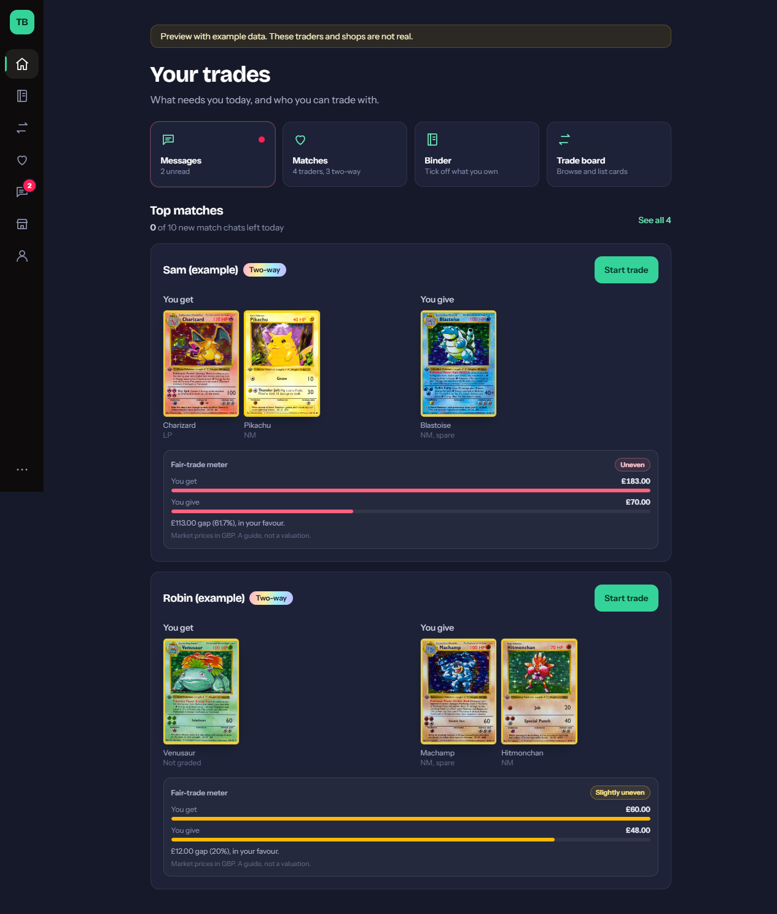
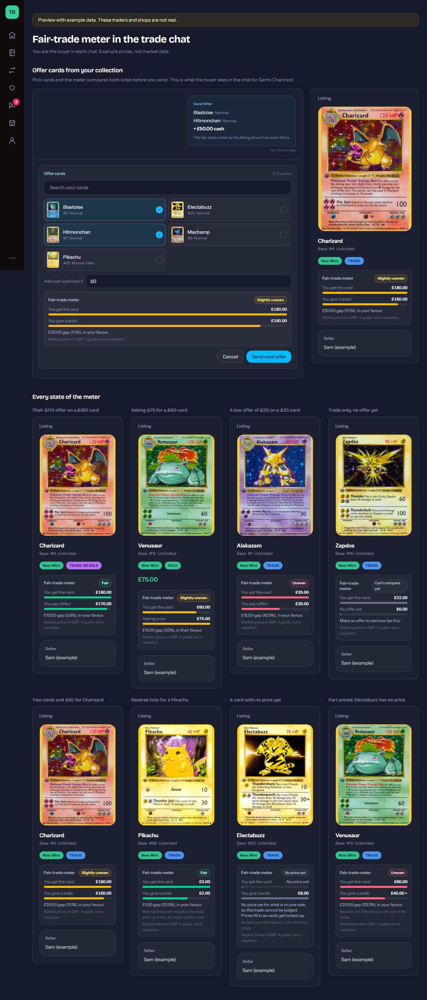
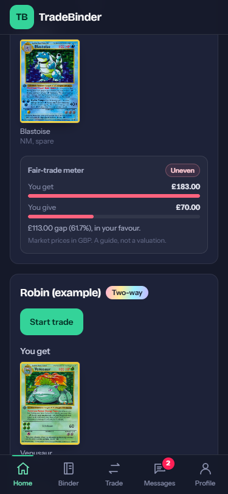
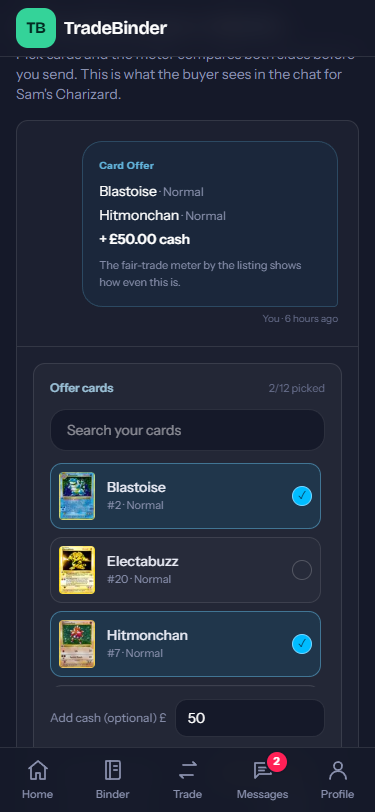
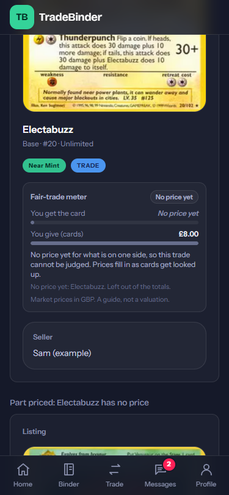

# Idea: fair-trade meter

**What it is**
- A panel showing each side's value in £, the gap in £ and %, and a **Fair / Slightly uneven / Uneven** badge.
- On every match card, and in the trade chat sidebar (the card vs the newest offer on the table: cards, cash, or the asking price).
- **Offer cards** in the trade chat: pick up to 12 cards from your collection, add cash if you like, and the meter compares both sides before you send.
- Reads the existing `card_prices` cache. No new tables or migrations.

**Why it pays**
- Strangers fear being ripped off. A neutral number starts more chats and closes more trades.
- Fewer "is this fair?" messages. Could later be a paid price check for shops.

**Try it in 2 minutes**
- `npm run demo`, open `localhost:3100/` and `/preview/fair-trade` (demo prices are made up).
- `npx vitest run tests/fairTrade.test.ts tests/cardOffer.test.ts`
- Refresh the screenshots: with the demo running, `node scripts/fair-trade-screens.mjs`.

**Rules:** a gap of 10% or less is fair, up to 25% is slightly uneven, more is uneven. A gap of £2 or less is always fair.

**No price yet:** a side where nothing is priced reads "No price yet" (never £0), and the badge says so. A part-priced side shows its total with a "+", is judged on what is priced, and lists the unpriced cards by name.

**Reverse holos:** the price cache stores only the base print, so a reverse holo is valued as that and the meter (and the offer card in chat) says so. Getting real reverse-holo prices needs the price route to store per-variant prices, which means a migration.

**How card offers are stored:** as a normal chat message with a readable first line and a tagged JSON line (`lib/cardOffer.ts`), so no migration and the current insert rules allow it. Prices always come from `card_prices` by card id, never from the message. The newest offer, cash or cards, is the one the meter uses. Card offers have no Accept/Decline buttons, because the offer status column only exists for cash offers (which must be above £0); people reply in the chat. Picker names come from the cached set lists for the 8 sets you own most of; other cards show as "set #number".

**Left to do (needs a migration, so Borty's call)**
- Accept/Decline on card offers: a `card_offer` message type or an `offer_cards` column.
- Per-variant prices, so reverse holos get their own value.

