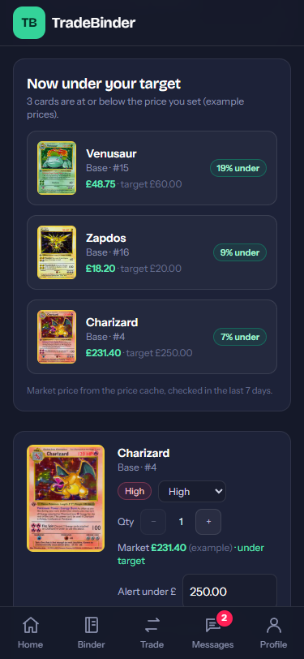
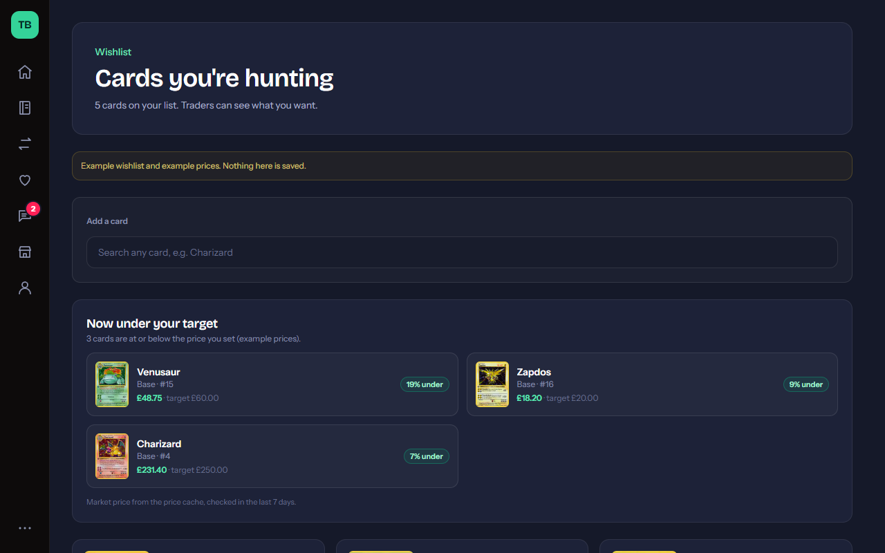
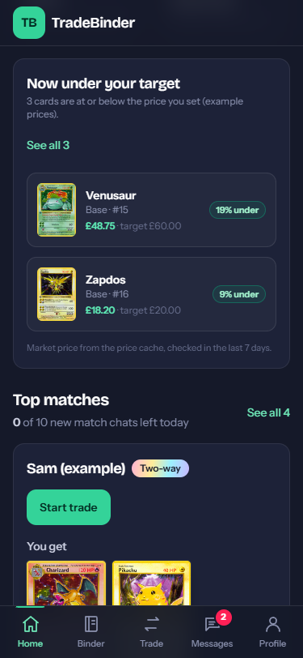
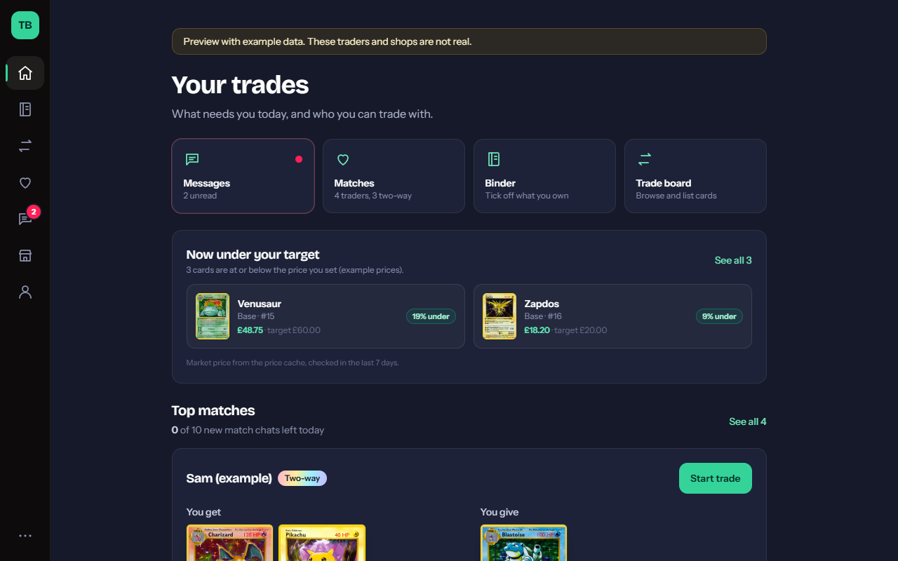

# Idea: price alerts on the wishlist

Branch `idea/price-alerts`, cut from `feat/overnight-inventory-shops-matching` at `4732baf` (draft PR #7). Not merged, no PR. The database change is a **proposal** and has not been applied anywhere.

## What it does

You set a target price on a wishlist card ("alert me under £60"). When the cached market price is at or under the target, the card shows up in a **Now under your target** section:

- **Wishlist page**: the full list, above your cards. Each card also gets a "Market £x" line and an **Alert under £** box. Leave the box blank for no alert.
- **Home page**: the top two, between the shortcuts and Top matches, with "See all" when there are more. The section is hidden when nothing is under target.

The point is to give people a reason to come back: their list does something when prices move.

| | Phone (375 px) | Desktop (1280 px) |
|---|---|---|
| Wishlist |  |  |
| Home |  |  |

The screenshots use the demo's example wishlist and **example prices**, and the page says so.

## How it works

- `lib/priceAlerts.ts` holds the pure logic. `findUnderTarget(wishlist, prices, { nowMs })` returns the alerts, biggest drop first. `parseTargetPrice` checks what people type in the box.
- The prices come from the existing `card_prices` cache (public read). The comparison uses `price_mid`, which the price route stores in GBP.
- The rules:
  - At or under the target counts, so a £10 target fires at £10.00.
  - Prices older than 7 days don't count. The cache only refreshes when someone views a card, so an old row could be months out of date.
  - Rows in another currency, and zero or blank prices, are skipped.
- `lib/priceAlertsData.ts` reads the cache 100 cards at a time.
- **Safe before the migration.** The wishlist page asks for `target_price`. If the column is missing (Postgres `42703` or PostgREST `PGRST204`), it reads again without it and hides the target box. The wishlist works exactly as it does today. The home hook gets an error and shows nothing.

## The database proposal (not applied)

The files are `supabase/proposals/023_wishlist_target_price.sql` and `023_wishlist_target_price_rollback.sql`. They sit outside `supabase/migrations` on purpose, so no `db push` or test boot applies them by accident. A test checks this.

- Adds `wishlist_cards.target_price numeric(10,2)`. It can be empty, and when set it must be more than 0 and no more than 100,000.
- No new policies. The existing owner-only update and public read already cover the column.
- The rollback drops the constraint and the column. Every other wishlist value is kept, and the rollback is safe to run twice.

## Tests

- `tests/priceAlerts.test.ts` has 13 unit tests:
  - the equal-to-target edge
  - stale prices and a custom max age
  - currency
  - numbers that come back as strings
  - sort order
  - the parser
  - spotting the missing-column error
  - the demo mix
- `tests/db/price-alerts.test.ts` has 6 PGlite tests that boot the database at 022 and apply the proposal. They check that:
  - the column and its check work
  - RLS lets only the owner set a target
  - real rows can be fed into `findUnderTarget`
  - the rollback brings back exactly the 022 shape of `wishlist_cards` and keeps every row
  - running the migration or the rollback twice is harmless

## Screenshots

With `npm run demo` running, run `node scripts/screens-price-alerts.mjs`. It uses DevTools device emulation, because headless Edge can't size a window as narrow as 375 px. The script also checks that no page scrolls sideways.

## Decisions for Borty

1. **Should a target be public?** Wishlists can be read by anyone, so a target would tell a seller the most you'd pay. Here are three options:
   - keep it public (simple, and it might even help deals)
   - move it to a separate owner-only table
   - leave it out of the public profile view

   The proposal keeps it public, but that is easy to change before applying.
2. **Notifications.** This version only shows alerts in the app. Email or push would need a scheduled job that refreshes `card_prices` for wished-for cards (today the cache only fills when someone looks at a card) and then sends the message. That costs money and sends messages, so it isn't built here.
3. **Which price.** It uses `price_mid` (market). Using `price_low` would fire sooner but more noisily.
4. **Example prices in the demo.** The demo's listings never show made-up prices. These alerts can't be shown without one, so the demo prices are labelled "example" on both pages.

## Not done

- Applying 023 anywhere.
- Notifications.
- Refreshing the cache for wished-for cards on a schedule.
- A target per variant. Targets are per card, just as the wishlist is.
